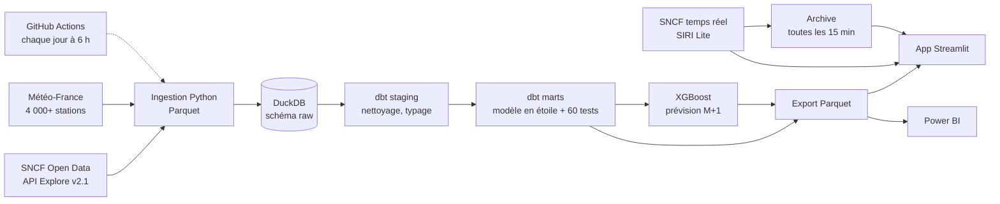
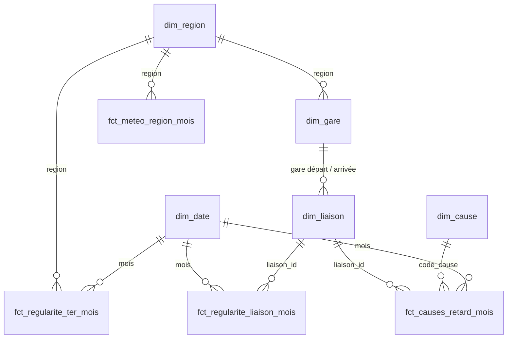

# 🚆 Observatoire de la ponctualité ferroviaire en France

[](https://ponctualite-ferroviaire.streamlit.app/) [](https://github.com/acherm75/observatoire-ponctualite-ferroviaire/actions/workflows/pipeline.yml) [](https://github.com/acherm75/observatoire-ponctualite-ferroviaire/actions/workflows/tests.yml)

Pipeline data de bout en bout, construit uniquement sur des **données ouvertes** (SNCF Open Data et Météo-France) :
ingestion automatisée, entrepôt analytique, modélisation en étoile avec dbt, tests de qualité, analyse exploratoire,
prévision par machine learning et restitution (Streamlit et Power BI).

> **Démo en ligne** : https://ponctualite-ferroviaire.streamlit.app/

## Ce que montrent les données

| Constat | Chiffre |
|---|---|
| Ponctualité moyenne 2025 | **TER 91,3 %** · **TGV 84,9 %** · **Intercités 84,0 %** |
| Liaison TGV nationale la moins ponctuelle en 2025 | Mâcon Loché → Paris Gare de Lyon : **69,4 %** |
| Les mauvaises liaisons le restent-elles ? | Oui : corrélation de rang de **0,80 à 0,89** d'une année sur l'autre, le problème est **structurel** |
| Origine des retards TGV > 15 min (2018 à avril 2026) | SNCF Réseau **43 %** · transporteur **27 %** · causes externes **23 %** · gares **8 %** |
| Mois les plus difficiles | **juin–juillet** (chaleur, affluence, travaux) et **novembre** |
| Effet météo, saisonnalité retirée | Réel mais modeste : un mois **plus chaud que la normale** est le signal le plus net (r = −0,22), le gel n'a quasiment pas d'effet |
| Prévision du taux de retard à M+1 | XGBoost : **−17 % d'erreur** par rapport à la référence « même taux que le mois dernier » |

Le détail est dans [`notebooks/exploration.ipynb`](notebooks/exploration.ipynb).

## En direct : le trafic SNCF en temps réel

L'onglet **🔴 En direct** complète les statistiques mensuelles par la situation du moment
([`app/temps_reel.py`](app/temps_reel.py)) : part des trains en retard par activité (TGV, Intercités, TER,
Transilien), plus gros retards en cours, prochains départs d'une gare avec voie et retard, et perturbations
annoncées. Les données viennent des flux publics **SIRI Lite** de la SNCF diffusés par le Point d'accès national
[transport.data.gouv.fr](https://transport.data.gouv.fr/datasets/horaires-sncf) (sans clé d'API),
actualisés toutes les 2 minutes. Même définition du retard que les statistiques mensuelles (≥ 5 min).

### Archive quotidienne : la ponctualité jour par jour

La SNCF ne publie la ponctualité qu'au mois. Pour la suivre **au jour le jour**, le flux temps réel est archivé
([`scripts/archiver_temps_reel.py`](scripts/archiver_temps_reel.py),
[`.github/workflows/temps_reel.yml`](.github/workflows/temps_reel.yml)) :

- le flux est une fenêtre glissante : un train y apparaît environ 1 h avant son départ et disparaît environ 10 min après son arrivée. Il est donc capturé **toutes les 15 minutes** ;
- pour chaque train, on garde la dernière observation : le **retard constaté** au terminus s'il a été vu arrivé, sinon le dernier retard estimé. Une arrivée constatée n'est jamais remplacée par une estimation ;
- chaque journée (jour de départ prévu) est clôturée le lendemain à midi, après l'arrivée des trains de nuit. L'agrégat par activité est commité dans `data/temps_reel/` et le détail train par train est publié en [release](https://github.com/acherm75/observatoire-ponctualite-ferroviaire/releases/tag/archive-temps-reel), hors du dépôt (environ 1 Mo par jour) ;
- l'état de la journée en cours vit dans le cache de GitHub Actions, ce qui évite un commit toutes les 15 minutes ;
- **fiabilité mesurée** : chaque journée a sa couverture (captures réussies / 96, les crons GitHub pouvant être retardés ou sautés) et sa part d'arrivées constatées. L'app écarte les journées couvertes à moins de 75 %.

## Assistant IA : poser une question en français

L'onglet **🤖 Assistant IA** de l'app répond à des questions comme *« Quelles sont les 5 liaisons TGV les moins
ponctuelles en 2025 ? »*. C'est un agent **text-to-SQL** ([`app/agent.py`](app/agent.py)) :

1. un modèle de langage gratuit (Google Gemini par défaut, ou Groq / Mistral) reçoit le schéma des marts et des règles métier (ex. recalculer un taux à partir des sommes, exclure les lignes incohérentes) ;
2. il écrit une requête DuckDB et l'exécute via un outil `run_sql`, lit le résultat et corrige la requête si elle échoue ;
3. il répond en français en ne citant que des chiffres issus des requêtes, qui sont affichées sous la réponse.

Pourquoi du text-to-SQL plutôt qu'un RAG sur des documents : les questions portent sur des chiffres, et une requête
sur les données exactes est vérifiable, là où un RAG paraphraserait des extraits.

Garde-fous : base en mémoire verrouillée (aucun accès disque ni réseau), une seule instruction `SELECT` par appel,
délai max de 10 s, 6 étapes max par question ; quotas par visite et par jour pour rester dans les limites gratuites du fournisseur, et relais automatique vers un autre modèle, puis vers un second fournisseur gratuit (ex. Groq), quand le quota d'un modèle est épuisé ou le service indisponible.

### Évaluation : 26 / 26 réponses justes

L'assistant est mesuré sur un jeu de **26 questions de référence** ([`evaluation/`](evaluation/)) : valeurs
nationales, classements, comparaisons, causes, météo, prévision, pièges connus (moyenne de taux au lieu d'un recalcul
à partir des sommes, dernier mois différent selon l'activité) et questions hors périmètre (horaires, prix, avion).

- Chaque question a une **requête SQL de référence** exécutée sur les données du jour : les réponses attendues suivent les mises à jour du pipeline.
- La **notation est déterministe**, sans LLM juge : la réponse doit contenir chaque valeur attendue (taux à 0,15 point près, libellés, volumes à 0,5 % près), et **un chiffre avancé sans requête réussie compte comme inventé**.
- Résultat actuel avec `gemini-3.5-flash-lite` : **26 / 26**, une requête SQL par question en moyenne, environ 2 s par réponse ([détail](evaluation/RESULTATS.md)).

L'évaluation a servi à corriger l'agent. Au premier passage, elle a révélé deux défauts :
- sur une question de prix hors périmètre, l'assistant refusait bien mais citait ensuite une ponctualité Paris–Marseille **sans l'avoir calculée** ;
- pour la part du matériel roulant, il filtrait les causes sur `libelle_cause ILIKE '%matériel%'` et comptait donc aussi « réutilisation de matériel » (29,8 % au lieu de 20,3 %).

Deux règles ajoutées aux consignes ont corrigé ces défauts, vérifiés ensuite par plusieurs relances.

```bash
python -m evaluation.lancer              # ~3 min avec les clés gratuites de .streamlit/secrets.toml
python -m evaluation.lancer --ids q08 q11
```

## Rapport Power BI

Le même modèle en étoile est restitué dans un **rapport Power BI de 7 pages**, versionné au format projet (PBIP) :
modèle en TMDL et pages en JSON, **entièrement générés par un script** ([`powerbi/generer_pbip.py`](powerbi/generer_pbip.py)).
C'est une démarche « BI as code » : le rapport se relit et se compare dans Git comme le reste du code.

- **42 mesures DAX** qui appliquent les mêmes règles métier que l'app : taux recalculés à partir des sommes, lignes incohérentes exclues, retard moyen pondéré, N-1 par décalage de 12 mois ;
- **pages** : synthèse, liaisons, causes, régions TER, météo, prévisions, et une **page Contrôle** qui recalcule dans Power BI des chiffres connus (TGV 2025 = 84,9 %, Mâcon Loché → Paris = 69,4 %…) pour prouver que le modèle donne les mêmes résultats que l'app ;
- **vérifié sans Power BI** : fichiers conformes aux schémas officiels Microsoft ([`powerbi/valider_schemas.py`](powerbi/valider_schemas.py)), et cohérence entre visuels, mesures DAX, modèle et données testée par `pytest`.

Ouverture, actualisation et export : [`docs/powerbi.md`](docs/powerbi.md).

## Architecture



| Couche | Outils | Rôle |
|---|---|---|
| Ingestion | Python, `requests`, `pandas` | Téléchargement des jeux SNCF (export Parquet de l'API) et des fichiers climatologiques mensuels Météo-France pour 95 départements |
| Stockage | DuckDB | Entrepôt analytique local, sans serveur |
| Transformation | dbt (adaptateur `dbt-duckdb`) | Staging → intermediate → marts, tables de référence (seeds), tests génériques et singuliers |
| ML | XGBoost, scikit-learn | Prévision du taux de retard par liaison pour le mois suivant, validée sur une période de test temporelle |
| Restitution | Streamlit, Plotly, Power BI | App publique et rapport BI sur le même modèle de données |
| Temps réel | Flux SIRI Lite SNCF (transport.data.gouv.fr), `xml.etree` | Trafic du moment, départs par gare, perturbations |
| Assistant IA | LLM gratuit via API compatible OpenAI (Gemini, Groq ou Mistral), outil SQL | Questions en français traduites en SQL sur les marts |
| Orchestration | GitHub Actions | Exécution quotidienne : tests dbt chaque jour, republication des données seulement si les sources SNCF ou le code ont changé (empreinte `scripts/fingerprint.py`) |

## Modèle de données



- **`fct_regularite_liaison_mois`** : TGV et Intercités, une ligne par liaison et par mois (trains prévus, annulés, en retard, retards > 15/30/60 min) avec la météo des départements de départ et d'arrivée.
- **`fct_causes_retard_mois`** : répartition des retards TGV entre 6 causes, au format long.
- **`fct_regularite_ter_mois`** : TER par région actuelle, avec la météo régionale.
- **`fct_meteo_region_mois`**, **`mart_ponctualite_nationale_mois`** : tables d'appui pour l'analyse et l'app.

## Qualité des données : problèmes trouvés et traités

Les tests dbt ont fait remonter des anomalies réelles dans les sources :

| Problème | Traitement |
|---|---|
| Depuis juillet 2025, certains axes TGV publient séparément les trains « National » et « International » (doublons sur la clé liaison × mois) | Type de service intégré à la clé de liaison |
| Intercités : deux lignes pour un même couple de gares et un même mois (ex. Paris–Toulouse jour et nuit), sans colonne pour les distinguer | Agrégation en staging, taux recalculé |
| Avril 2020 : plus d'annulations que de trains prévus | Lignes marquées `est_incoherent`, taux laissés vides |
| 272 lignes TGV avec toutes les causes à 0 % | Traitées comme « répartition inconnue », pas comme 0 % |
| Mai 2026 : rupture brutale dans la répartition des causes | Signalée dans l'analyse et dans l'app (probable changement de nomenclature) |
| Régions TER publiées selon l'ancien puis le nouveau découpage, et lots ouverts à la concurrence en 2025 | Table de correspondance vers les 13 régions actuelles |
| Noms de gares différents selon les jeux (`PARIS-EST` / `PARIS EST`) | Normalisation (macro dbt) et référentiel des gares |

## Tests

Deux niveaux de contrôle, lancés automatiquement par GitHub Actions :

- **Données** : 60 tests dbt (unicité, relations, valeurs plausibles, causes qui somment à 100 %) à chaque exécution du pipeline.
- **Code** : 161 tests `pytest` ([`tests/`](tests/)) à chaque push, sans réseau ni clé d'API :
  - *assistant IA* : seules les requêtes `SELECT` passent (écriture, `ATTACH`, `COPY`, `SET`… refusés), aucun accès disque même via `read_parquet`, délai max, troncature ; boucle de l'agent avec un faux modèle (correction après erreur SQL, limite d'étapes, relais vers le modèle suivant quand le quota est épuisé) ;
  - *temps réel* : lecture d'extraits SIRI Lite (retard au terminus, seuil de 5 min aux bornes, suppressions totales ou partielles, perturbations en cours, texte nettoyé du HTML) ;
  - *prévision* : **aucune fuite d'information du futur** — modifier un mois et les suivants ne change aucune variable de ce mois.

  - *archive temps réel* : fusion des captures (dernière observation, arrivée constatée prioritaire, capture en double ignorée), jour de service en heure de Paris, clôture à J+1 midi, agrégats et couverture ;
  - *rapport Power BI* : champs des visuels et références DAX présents dans le modèle, colonnes identiques aux Parquet, relations sur des clés uniques ;
  - *évaluation* : notation (nombres à la française, libellés, refus) et validité des 23 requêtes de référence.

  Les tests ont été validés par mutation : en réintroduisant volontairement une fuite, en rouvrant l'accès disque ou en décalant le seuil de retard, au moins un test échoue.

```bash
pip install -r requirements-dev.txt
pytest tests
```

## Lancer le projet

```bash
python -m venv .venv && source .venv/bin/activate
pip install -r requirements.txt

python pipeline.py                 # ingestion -> DuckDB -> dbt build -> ML -> export (~2 min)
python pipeline.py --skip-ingest   # retransformer sans retélécharger

pip install -r app/requirements.txt
streamlit run app/streamlit_app.py
```

Commandes dbt seules :

```bash
cd transform && export DBT_PROFILES_DIR=.
dbt build                           # modèles + tests
dbt docs generate && dbt docs serve # documentation et lignage
```

## Structure

```
ingestion/        téléchargement SNCF + Météo-France, chargement DuckDB
transform/        projet dbt (seeds, staging, intermediate, marts, tests)
ml/forecast.py    prévision XGBoost + backtest
notebooks/        analyse exploratoire
app/              application Streamlit (dont assistant IA et temps réel)
data/marts/       tables finales en Parquet (versionnées, mises à jour par la CI)
data/temps_reel/  ponctualité jour par jour issue de l'archive temps réel
powerbi/          rapport Power BI au format projet (PBIP), généré par script
evaluation/       évaluation de l'assistant IA (questions de référence, notation)
scripts/          empreinte des données, export, archivage temps réel
tests/            tests pytest
docs/powerbi.md   ouverture et vérification du rapport Power BI
pipeline.py       point d'entrée unique
```

## Pistes suivantes

- Jeu de questions de référence pour évaluer l'assistant (exactitude des chiffres renvoyés)
- Archiver chaque jour le flux temps réel pour mesurer la ponctualité au jour près
- Granularité journalière de la météo pour isoler les épisodes extrêmes (canicules, tempêtes)

## Sources

- [SNCF Open Data](https://ressources.data.sncf.com) : régularité mensuelle TGV (AQST), TER, Intercités ; fréquentation des gares. Licence ODbL.
- [Météo-France, données climatologiques de base mensuelles](https://www.data.gouv.fr/fr/datasets/donnees-climatologiques-de-base-mensuelles/). Licence Etalab 2.0.
- [SNCF, horaires et temps réel (SIRI Lite)](https://transport.data.gouv.fr/datasets/horaires-sncf), via le Point d'accès national transport.data.gouv.fr. Licence ODbL.
